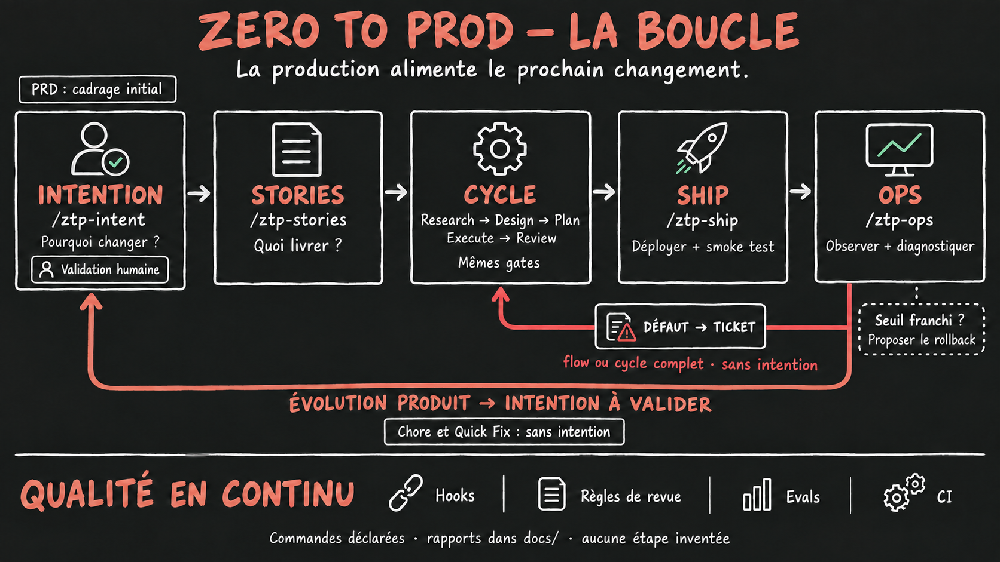

# Zero to Prod — the method

Zero to Prod is a software delivery method driven by AI agents (Claude Code, Codex). It takes a project from an idea to production: a web or mobile application, an internal tool, an API, a new project or an existing codebase, on any stack.

It rests on one observation: an agent produces plausible code, and plausible is not correct. The method therefore organizes the work so that every claim is verified by a context that did not write it, and every step blocks until the previous one is proven.

This document explains the method. The exact rules live in `src/AGENTS.md` and in each command; where they differ from this page, they win.

## 1. Principles

**No code outside the pipeline.** No feature is written without a story, a validated plan and a review. The context that drives execution does not have the write tools: it delegates to an implementation agent. The rule is carried by the tooling, not by good intentions.

**The context that writes never reviews itself.** An agent is blind to its own mistakes. Reviews — of the breakdown and of the code — run in fresh-context, read-only subagents.

**Everything blocks by default.** No validated plan, no execution. A critical defect in review, no ship. A red smoke test in production, no ship. Nothing is forced through.

**Each check runs once, and once only.** A deterministic command re-run on the same code returns the same answer. Focused tests run during the work, the full suite and the type check once at the end, end-to-end tests and the production build once when shipping.

**The artifacts are the state.** Markdown under `docs/` holds the pipeline records, with
explicit links when the tracker is authoritative. Progress is derived from those sources
and git; no parallel state database is maintained.

## 2. Framing — once per project

| Step | Command | What it produces |
|---|---|---|
| Settings | `/ztp-setup` | `AGENTS.local.md`: where a story lands, who validates a plan, who draws the screens, the project's commands. Four questions; everything else has a default. |
| Product frame | `/ztp-prd <idea>` | `docs/prd.md`: the WHAT and the WHY, never the HOW. |
| Breakdown | `/ztp-stories` | `docs/stories.md`: stories shippable end to end. |
| Breakdown review | `/ztp-stories-review` | `docs/reviews/stories.md`: perimeter coverage checked in a fresh context. |
| Architecture | `/ztp-architect` | The stack, a verified foundation, the conventions, the environments and the deployment. |
| Design system | `/ztp-design-system` | `docs/design-system.md` and its showcases in `docs/design/`, from your input or from three directions drawn by the tool you choose — you pick one. Then the foundations in the code, validated step by step: tokens, CSS framework, components, layout and empty page templates. Contrasts measured once. Only for a product with a user interface. |

**The product frame** starts with **idea validation**: the problem and what it costs today, the users, and the unproven hypothesis the project stands on, with the measurable signal that will confirm it. This is what stands in for a specification when no reference product exists. Then come the **starting point** (new project, existing codebase, replacement of a product or system) and the **product type**, an optional **reference** (existing product, legacy system, mockups), the **perimeter** (each feature scored for complexity 1 to 5), the exhaustive **out-of-scope** list, the constraints and measurable success criteria. Nothing is filled in without the user's validation.

**The breakdown** produces stories that each deliver shippable value, never a technical layer ("create the table" is not a story; the table is created inside the story that needs it). Every acceptance criterion must be able to become a test. Every story carries an id `s<number>-<slug>` that names all its files and its branch, a complexity score (a 5 is split before planning) and notes for the agent. The breakdown review walks the perimeter table first: a promised feature covered by no story is the most expensive defect in the pipeline, invisible until ship.

**The architecture** follows the starting point.
- *Existing codebase*: the agent maps it (structure, conventions, anchor points) and conforms to it, never proposing a rewrite.
- *New project*: the user does not need to be an architecture expert. The agent **recommends one stack**, justified by the PRD and by what the team already masters, with the alternatives it ranks lower. The user accepts or changes it; each structural choice becomes a recorded decision (ADR). The agent then **builds the foundation** with the stack's official generators: structure, tooling, one passing example test, documented environment variables, the pipeline's scripts.

Either way, the conventions are written as rules the development agents can apply, and the **environments and the deployment** are defined once in `docs/deployment.md`: production (and staging if it exists), what triggers a deployment, the smoke test, the rollback procedure and what it does not undo. The phase ends with an **executed checklist** (`docs/foundation.md`): install, example test, type check, lint, build, start in the target environment, secrets kept out of the repository, commands and conventions true to the code. On a new project every applicable item must be green. The design system's foundations are the only other code written outside a story (`/ztp-design-system`).

Then **architecture → rules**: from the code just verified or mapped — never from the intention — the agent poses one minimal rule per zone that exists (components, services, data access, tests…): a few imperative lines and one real file as an anchor, nothing the method's rules already say. Under Claude Code each rule is a `.claude/rules/<zone>.md` scoped by `paths:`, loaded only when an agent touches that zone. Codex loads no nested `AGENTS.md` below its working directory, so it gets an index instead: `AGENTS.local.md` lists each zone, its paths and its rule file, and reaches Codex through `AGENTS.md`. The detail lives only in the rule, the index only points to it, and `install.sh --check` reports any gap between the two.

## 3. La boucle

    New product change → Intent → Stories → Existing cycle → Ship → Ops
                           ↑                                      │
                           └── product evolution, after validation ┘
                                     defect → ticket → cycle

**Intent is for new changes on an existing product.** Initial framing stays the PRD.
`/ztp-intent` interviews the originator one question at a time, following each branch to a
shared understanding. Only confirmed answers are recorded; explicit human acceptance makes
the intent usable. The intent carries the **why** (problem, expected outcome, users,
constraints, open questions); stories carry the **what**. It lives in `docs/intents/`, or in
the declared ticket tracker with a local pointer. `/ztp-stories <intent>` adds its stories
without rewriting the PRD or existing work. The breakdown review reads both sources.

**A defect needs no intent.** It becomes a ticket, then uses flow or the full story cycle
according to the existing escalation rules. Its execution brief in `docs/tickets/` links
back to the tracker; it never enlarges the product perimeter. Chores and Quick Fix also need
no intent. A request to restore promised behavior is different from a new product outcome.

**Ship now hands off to observation.** After the deployment and its smoke test, `/ztp-ops`
reads the declared deployment logs/error tracking for that release and observation window.
It reports new related errors and proposes the documented rollback when the declared
threshold is breached. The smoke-test rollback rule itself is unchanged. On demand or from
a configured scheduler, `/ztp-ops last N days` also examines recurring errors, performance
and usage where those sources exist. Reports persist in `docs/ops/` after worktree cleanup.

Every finding gets a tracked follow-up: an existing/new defect ticket, a validated product
intent, or an explicitly pending human interview. A headless run cannot invent the human's
answers. No observability command → it says so and stops; failed collection or an incomplete
window never means healthy. Setup offers deployment logs and error tracking without making
either mandatory, including `/ztp-setup --observability` for an existing install.

## 4. The cycle — once per story

One story = one `feature/<id>` branch = one dedicated worktree = one PR = one commit on the target branch.

    Research → Design → Plan → Execute → Review → Ship

| Step | Who | What matters |
|---|---|---|
| **Research** | main agent | The real state of the code, not the one the docs describe. Checks the story's **premise**: a function that exists but fails on the story's case invalidates the story. Re-scores complexity. |
| **Design** | main agent | Screens derived from the design system, nothing invented. An existing screen changed: a list of deltas, no mockup. A new screen: exactly one mockup, rendered and looked at in the target environment. Validated by a human or by the agent per `Design validation`; `validated: yes` conditions the plan. |
| **Plan** | main agent | Small verifiable tasks, the story's interdicts, the point everything turns on, the test strategy. Validated by a human or by the agent per the settings; `validated: yes` conditions execution. |
| **Execute** | `implementer` subagent | **Acceptance tests first**: one per criterion, proven red on its assertion, reviewed (by the reviewer in fresh context, or a human) and **frozen** in their own commit. Then the code, task by task, running only the test files concerned, until green; the full suite and the type check once. Writes a **verification record** that ties the results to the exact code tree — kept in the worktree, never committed. |
| **Review** | `reviewer` subagent, fresh context | Checks the frozen tests were not touched, opens every import and API the diff cites, compares the diff to the plan, and **spot-checks the bite**: it neutralizes the central invariant and counts the tests that turn red. Zero red means the invariant is untested. |
| **Ship** | main agent | Exit gate (end-to-end, build), squash merge, **deployment, smoke test in production**, documented rollback if red, cleanup only after proof. |

**Only a critical defect blocks.** A major stays traced in the report and is fixed in a next cycle; a minor is style. Two fix loops at most. **A defect is not a story**: it goes to the issue tracker, not into the perimeter.

**Three tracks, the same gates.**
- *Full pipeline*: the six steps, six contexts.
- *Short track* (`/ztp-flow`): for a simple story, research and plan fused into one pass, then the same implementer, the same review, the same ship. A migration, a new screen, an authorization or API contract change, or an added dependency sends it back to the full pipeline, even mid-flight.
- *Quick Fix*: on explicit request, for a local, reversible adjustment with no business impact (a color, a label). Everything else goes through the pipeline.

`/ztp-orchestrator` chains a full cycle with its human checkpoints (validate the design when `Design validation: human`, validate the plan, confirm the ship); `/ztp-status` shows progress and the next useful command.

## 5. Gates and tests

| Gate | Check | What it blocks |
|---|---|---|
| Design validated | `validated: yes` in `docs/designs/<id>/design.md` (stories with a screen) | The plan |
| Plan validated | `validated: yes` in `docs/plans/<id>.md` | Execution, and any code commit on the story branch (git hook) |
| Acceptance tests mapped | One row per story criterion in the plan's "Acceptance tests" table (`UI check` for a visual one), within `Test budget` — the only budget, no override | Plan validation, execution, and the tests review |
| Tests frozen | The files listed in `docs/tests/<id>.md` unchanged since the `test(<id>)` commit | The review: a frozen test edited after validation is critical |
| Records only | `docs/verif/` holds only `<id>.md` records; throwaway proof lives in `.ztp/evidence/<id>/` | The ship; a major at review |
| Verification current | The tree recorded in `docs/verif/<id>.md` (local, gitignored) matches the commit | Decides whether the review trusts the results or replays them; a missing record (fresh clone, CI) means they are replayed |
| Ship allowed | `Ship allowed: yes` at the end of `docs/reviews/<id>.md` | The ship, entirely |
| Production verified | Green smoke test after deployment | The story's cleanup; a red one triggers the rollback |

These gates are file reads, not judgment calls: they work the same under Claude Code, under Codex and in CI (`ztp-gate.sh`).

**Testing doctrine: test-first, at the level of the acceptance criterion.** Each criterion gets one test, not each function. The test is run before any code and must be red for the right reason — the assertion fails, not an import: skeletons (signatures returning a neutral value) make that possible. It is then reviewed by a context that did not write it, and **frozen**: during the code phase the agent may not modify it, and a test it believes wrong stops the work. The code is written until green, running only the test files concerned; the full suite runs once.

What stays: each rule is tested once, at the layer where it lives; the test budget per story (25 by default) is the ceiling; most tests are unit or service tests with a mocked repository, a real database for DAOs only, one end-to-end per story. The criterion that replaces the count: **a test that stays green when the rule it names is deleted is worse than no test.** The neutralization in review remains, as a spot check rather than the main guarantee.

This now follows the Anthropic playbook's test-first feedback loop, at the level of the acceptance criterion, with the freeze and the independent review that keep the agent from bending its own tests.
See [the playbook's feedback-loop lesson](https://academy.claude.com/courses/ai-native-sdlc-playbook/give-claude-a-feedback-loop).

## 6. Tools, installation, settings

One source (`src/`), one installer, one output per tool:

    curl -fsSL https://raw.githubusercontent.com/MikeCodeur/zero-to-prod/main/install.sh | bash                      # Claude Code
    curl -fsSL https://raw.githubusercontent.com/MikeCodeur/zero-to-prod/main/install.sh | bash -s -- --target codex  # Codex

**The project's nature is settled once.** `/ztp-architect` writes a *project profile* in `AGENTS.local.md` — product type, target environment, how a screen is checked (`UI check`, or `—` when there is no user interface), end-to-end tool. Every agent reads it and never asks again, nor proposes a tool it does not name: no browser test on a C++ program.

**No stack is assumed.** The pipeline never runs a command it invented: it runs the project's own commands (test, typecheck, e2e, build, deploy, smoke test), quoted from `AGENTS.local.md`. The same stages hold for a web app, a mobile app, a C++ program or a library: in a compiled language the compile step is the type check, the "production build" is the release build, and "production" is wherever users get the product — a server, a registry, an installer.

Options: `--target claude|codex|all`, `--global` then `init` per project, `update`, `--check` (lists installed files modified locally), `--hooks` (gates enforced by git). The rules live in `AGENTS.md`, read natively by both tools; the project's settings in `AGENTS.local.md`, which the installer never touches. Commands are slash commands under Claude Code and skills under Codex. The guarantees carried by tool permissions are mechanical under Claude Code and looser under Codex; that is why the gates are also carried by the repository.

With `--hooks`, Git also rejects staged secrets and declared protected paths. Claude Code
additionally blocks declared production commands and checks the target's approval before
a declared merge. Project paths and command patterns come from `AGENTS.local.md`; nothing is
guessed. Hooks are local guardrails, not an OS sandbox or a replacement for branch protection.

## 7. Learning and regression checks (optional)

`/ztp-review-learn` turns sourced human PR feedback into proposed report/ignore rules. Only
tech-lead approval activates `docs/review-rules.md`; the reviewer reads it alongside its
generic checklist. Local preferences cannot weaken the existing gates or hide a critical.

`/ztp-eval` collects 20–50 already accepted tasks in `docs/evals/`, pins their starting and
accepted commits, and replays them headlessly with the current declared model/rules/skills.
Independent checks judge the result; model claims do not. Reports record the configuration,
task set and exits. This checks the agent configuration, without changing the testing doctrine
for a product story. Without declared runners or enough proven tasks, no suite pass is claimed.

`--ci` installs an optional PR workflow calling the existing gates. Fresh-context review and
evals are explicit opt-ins, off by default. Automated build repair is documented as a project
extension through a new PR and the existing gates; installation never enables it.

## 8. Known limits of V1

- **Team mode.** The method assumes one operator per repository: no distribution of stories between people, no lock on a story in progress, no convention for cross human review. To be addressed in V2.
- **Mobile.** The "target environment" abstraction covers screen verification; native builds, signing and store publication are not covered.
- **Tools.** Claude Code and Codex only.
